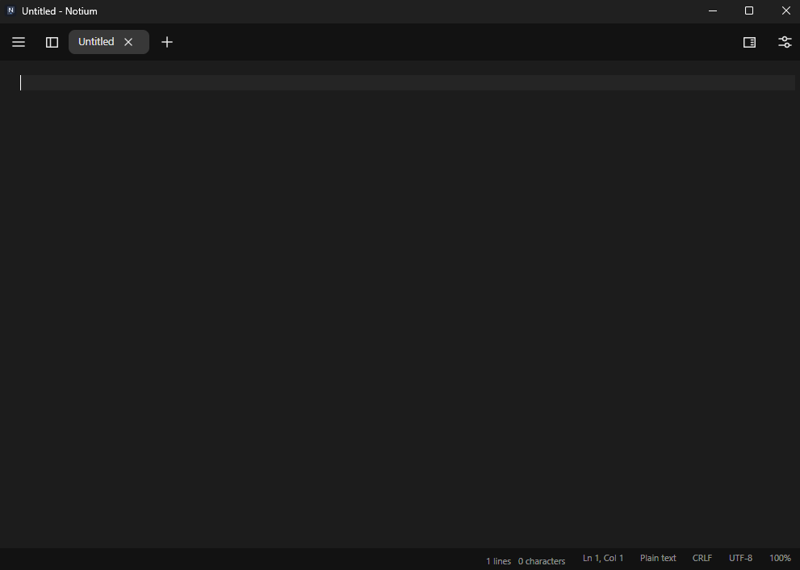
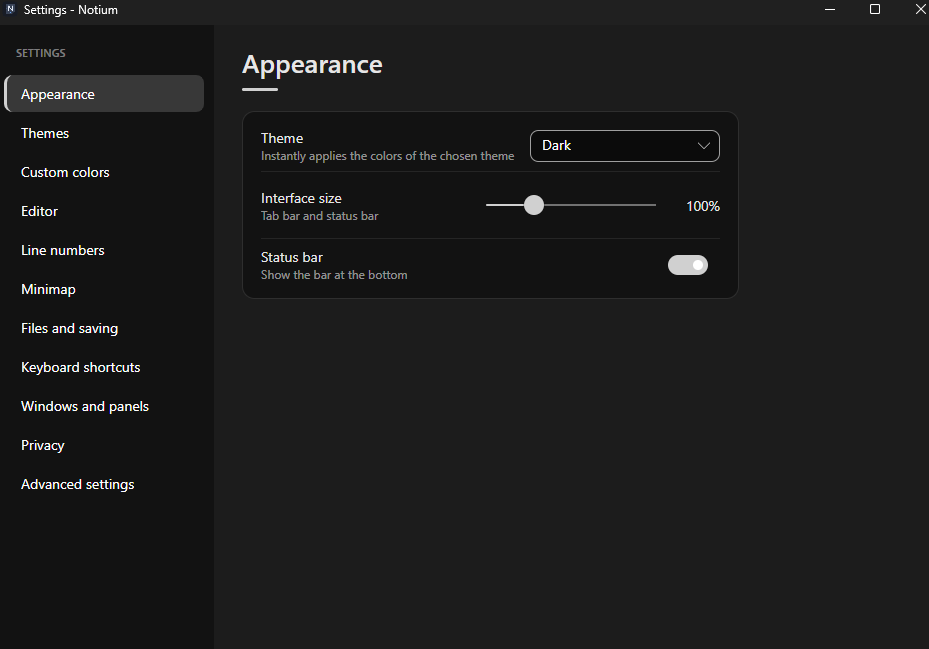

# Notium

<p align="center"><b>A modern, fast and fully portable text editor for Windows, Linux and macOS.</b><br>
Offline. No installation, no account, no AI, no ads, no telemetry.</p>

Notium combines the simplicity of Notepad with the customization of professional editors, in a clean dark interface. The same source code runs on every system, and the whole program lives in a single folder you can carry on a USB stick.

---

## Screenshots

<p align="center"></p>
<p align="center"><em>The main window: tabs, a clean editor and the status bar.</em></p>

<p align="center"></p>
<p align="center"><em>The settings window: themes, colors, editor options and keyboard shortcuts.</em></p>

---

## Installation tutorial

Notium needs no installer. You download this folder, start it once, and the first start builds the program for your computer. After that you only need the small `Notium-portable` folder.

### Requirements

| | |
|---|---|
| **Windows** | Windows 10 or 11, 64-bit (x64 or ARM64) |
| **macOS** | macOS 11 or newer, Intel or Apple Silicon |
| **Linux** | A desktop session (x64 or ARM64), `curl` or `wget`, and the usual desktop libraries (see [Troubleshooting](#troubleshooting)) |
| **Internet** | Only for the first start |
| **Disk space** | About 1.5 GB free during the first start. Afterwards the program uses far less: only the `Notium-portable` folder stays |
| **Folder** | Any folder you can write to (Documents, Downloads, a USB stick). Not `Program Files` or other protected places |

You do **not** need to install .NET, Python or anything else: the launcher takes care of it.

### Step 1 - Get the folder

Download the project as a ZIP file (on GitHub: **Code > Download ZIP**) and unzip it. You get a folder called `Notium` with this content:

```
Notium/
├── start-windows.bat
├── start-mac.command
├── start-linux.sh
├── src/
├── scripts/
└── ...
```

### Step 2 - Start it for your system

**Windows**

1. Open the `Notium` folder and double-click **`start-windows.bat`**.
2. If Windows shows a blue "Windows protected your PC" window, click **More info**, then **Run anyway**. (The launcher is a plain text script, not signed with a paid certificate.)
3. A black terminal window opens and shows the progress in percent. Leave it open.
4. When it says **Done. Starting Notium...** the program opens by itself and the terminal closes.

**macOS**

1. Open the `Notium` folder and double-click **`start-mac.command`**.
2. If macOS says it cannot be opened because the developer cannot be verified: right-click the file, choose **Open**, then **Open** again. (Or: System Settings > Privacy & Security > **Open Anyway**.)
3. A Terminal window opens and shows the progress in percent. Leave it open.
4. When it says **Done. Starting Notium...** the program opens by itself.
5. If you get "permission denied", open Terminal, type `cd ` followed by the path of the folder (you can drag the folder into the Terminal window), press Enter, then run `chmod +x start-mac.command` and double-click the file again.

**Linux**

1. Open a terminal in the `Notium` folder.
2. Run:
   ```
   chmod +x start-linux.sh
   ./start-linux.sh
   ```
   (Many file managers also let you right-click the file and choose "Run in terminal".)
3. The terminal shows the progress in percent. Leave it open.
4. When it says **Done. Starting Notium...** the program opens by itself.

### Step 3 - Wait for the first start

The first start takes a few minutes. The launcher shows these steps:

| Progress | What it is doing |
|---|---|
| 0% | Downloading the components it needs from Microsoft (the .NET SDK) |
| 50% | Downloading the libraries and building Notium. This step can look frozen for a few minutes: it is working |
| 90% | Creating the `Notium-portable` folder |
| 100% | Done: Notium starts. The temporary files are removed in the background |

Nothing is installed on your system: no registry entries, no files in your user folder. Everything happens inside the Notium folder.

### Step 4 - Use it

From now on, start Notium in either way:

- run the launcher again (it just opens the program, in about a second), or
- open the **`Notium-portable`** folder and run the program directly: `Notium.exe` on Windows, `Notium-linux` on Linux, `Notium-mac` on macOS.

**`Notium-portable` is the whole program.** It holds the executable, a few small libraries and, once you use it, your settings in `data/`. You can now delete everything else (the launchers, `src/`, `scripts/`, `images/`, README) and keep only `Notium-portable`. You can copy it anywhere, even to a USB stick, and it works offline with all your settings.

Tips:

- **Windows:** right-click `Notium.exe` > **Pin to taskbar**.
- **Make Notium the default editor for `.txt`:** right-click a text file > **Open with** > choose the Notium program > tick **Always use this app**. Notium does not change file associations by itself.
- **Another computer or system:** copy the whole `Notium` folder (with the launchers and `src/`) and start the launcher there: it builds the program for that system. A `Notium-portable` built on Windows does not run on Linux or macOS, and the other way around.

### Is it working?

When Notium opens you see a dark window with one empty tab and a **+** button. Type something and the tab shows a small dot (modified). Press `Ctrl+S` to save. If that works, the installation is complete.

---

## Features

**Tabs and windows**
- Several documents in tabs, with a modified indicator; the active tab stands out.
- Close a tab with its X, a middle click or `Ctrl+W`; reopen it with `Ctrl+Shift+T`; open a new one with `Ctrl+T`.
- **Pinned tabs** (right-click a tab > Pin tab, or `Ctrl+Shift+P`; the same menu has **Copy path** and **Open containing folder**): a pinned tab moves to the left, shows a pin instead of the X and cannot be closed by mistake (X, middle click and `Ctrl+W` are ignored until you unpin it). Pins are kept when tabs are restored.
- **One running program, like Windows Notepad:** if Notium is already running and you open a file with it again (double-click, "Open with", command line), nothing new starts. The file opens as a new tab at the end of the tab bar of the window already open. If the file is already open, its window comes to the front (even when minimized) with the right tab selected.
- Multiple windows (`Ctrl+Shift+N`). When you drag a tab out of the tab bar, a small label with its name follows the mouse, as on Windows; release it to open the tab in its own window, or drop it on another window to move it there.
- **Window size is remembered**: Notium opens with the size (and maximized state) you left it, saved in `data/settings.json` (Settings > Windows and panels). Draggable tabs: reorder them, drag one out to detach it into a new window, or drop it onto another window.
- Notepad-like behavior: Notium asks "Do you want to save changes?" only for documents that contain text or were modified. If you answer "Don't save", a second question asks you to confirm, so nothing is thrown away by mistake. Closing the last tab of the last window, or pressing the window X, quits the program.
- **Restore tabs on start** (on by default, Settings > Files and saving): when you quit, your tabs are kept, including unsaved text, and they come back at the next start without any save prompt. Turn it off to start from an empty document like Notepad does; then Notium asks about unsaved changes on exit.

**Any programming language**
- Notium is a plain text editor first, and a new document starts as plain text.
- **Automatic recognition:** if you start typing code in a new document (Python, JavaScript, HTML, SQL, C, Go, Rust, shell scripts...), Notium recognizes the language and colors it. The detection is cautious: when it is not sure, the text stays plain.
- **Saving:** a recognized document is offered with the usual extension of its language (`.py`, `.js`, `.html`...), plain text with `.txt`. You can always **type any other extension in the file name** (`script.py`, `main.rs`, `notes.md`...) and the program follows it, also for the coloring.
- You can pick the language by hand at any time (status bar or Format > Language); from then on Notium stops guessing for that document.
- Syntax coloring for hundreds of languages and formats (TextMate grammars, the same as VS Code), including Python, JavaScript, TypeScript, C, C++, C#, Java, Kotlin, Swift, Go, Rust, PHP, Ruby, Lua, SQL, HTML, CSS, JSON, YAML, XML, Markdown, shell scripts, PowerShell, Dockerfile, Makefile and many more.
- Files without a known extension stay plain text.

**Editing**
- Find and replace (`Ctrl+F` / `Ctrl+H`) with match case, regular expressions and a match counter.
- **Find in files** (`Ctrl+Shift+F`): search all open tabs or a whole folder, with a file filter such as `*.py;*.js`; double-click a result to open it at that line.
- **Replace in files**: the same window (`Ctrl+Shift+F`) has a "Replace with" field. "Replace all..." first shows a **preview** of every file and line that will change (old line in red, new line in green) and asks for confirmation. Files open in a tab are changed in the tab and left unsaved, so `Ctrl+Z` undoes it; files on disk are written immediately. Regular expressions can use `$1`, `$2`...
- **Bookmarks**: `Ctrl+F2` marks the current line (it is tinted with the accent color), `F2` / `Shift+F2` jump to the next / previous one. Bookmarks follow their line while you edit and last as long as the document is open.
- **Go to line** (`Ctrl+G`), also as `line:column`.
- Move lines up and down (`Alt+Up` / `Alt+Down`), duplicate and delete line, **toggle comment** (`Ctrl+/`, the marker depends on the language).
- Transform text (selection or whole document): UPPERCASE, lowercase, Title Case, sort lines, reverse lines, remove duplicate or empty lines, trim trailing spaces, remove double spaces, keep at most one empty line in a row, tabs to spaces, spaces to tabs, capitalize sentences.
- **Clean up when saving** (on by default, Settings > Files and saving): removes spaces at the end of lines (not in Markdown) and collapses several empty lines into one. Two more options, off by default because they can change code or aligned text: remove double spaces, and convert tabs to spaces. Everything can be switched off.
- Word wrap on by default, insert date and time, current-line highlight, optional visible spaces and tabs.
- Zoom with `Ctrl` + mouse wheel, `Ctrl+Plus`, `Ctrl+Minus` and `Ctrl+0`.
- Distraction-free mode (`F11`): full screen, no bars, centered column of text. `Esc` leaves it.

**Files and folders**
- **Notium remembers where you were**: when you reopen a file, the caret and the view return to the last position (the last 300 files are remembered).
- Open several files, drag and drop, recent documents, and files passed on the command line or with "Open with".
- **Folder panel** (`Ctrl+B`): browse the files of a folder and your recent documents; double-click to open.
- Large files open without freezing the window; files over 100 MB ask first.
- Safe saving through a temporary file; optional `.bak` backup before overwriting.
- Files changed by another program reload by themselves if you did not edit them, otherwise Notium asks.
- Encodings: UTF-8, UTF-8 with BOM, UTF-16 LE/BE, ASCII, Windows-1252 (auto-detected). Use **Reopen with encoding** if the detection is wrong, or **Save with encoding** to convert. Line endings: CRLF, LF, CR (auto-detected, changeable).
- **Print with preview** (`Ctrl+P` or File > Print): the document opens as a clean black-on-white page in your default browser, whose print dialog shows the preview, the page layout and the printer choice. Line numbers are printed if they are on in Notium. The temporary page is stored in `data/print/` and old ones are removed automatically.
- Save dialogs like Notepad: `.txt` by default, with an overwrite confirmation.

**Status bar**
- Lines, **words** and characters (click: details with reading time, and the same numbers for the selection), line and column (click: go to line), language (click: choose), line ending, encoding and zoom (click: reset). Each one is clickable.

**Look**
- Neutral dark interface by default (black, white, grey): rounded, modern and fully opaque, with soft hover animations.
- Seven themes: Dark, Light, Midnight, Nord, Dracula, Monokai, Solarized.
- Font, size, bold, tab size and interface size (80% to 160%).
- Line numbers and a minimap, both off by default.

## Menus at a glance

Right-click the editor, or use the menu button, to reach every command. Shortcuts are shown next to each item.

| Menu | What it contains |
|---|---|
| **File** | New tab, New window, Open, **Open folder**, Recent documents, Save, Save as, Print (preview), Close tab, Reopen closed tab, Pin / unpin tab, Exit |
| **Edit** | Undo, Redo, Cut, Copy, Paste, Select all, Find, Replace, Find and replace in files, Go to line, **Bookmarks** (toggle, next, previous, clear), Duplicate / delete / move line, Toggle comment, **Transform**, Insert date and time |
| **Format** | Reopen with encoding, Save with encoding, Line ending, Language, Word wrap |
| **View** | Folder panel, Distraction-free mode, Zoom in / out / reset, Line numbers, Minimap, Visible spaces and tabs, Highlight current line, Status bar |
| **Settings** | The settings window (`Ctrl+,`) |

## Keyboard shortcuts

Use `Cmd` instead of `Ctrl` on macOS.

**Every shortcut can be changed** in Settings > Keyboard shortcuts: click a shortcut and press the new keys. You can reset a single shortcut, or all of them at once, to the defaults. The table shows the defaults.

| Action                         | Shortcut                  |
|--------------------------------|---------------------------|
| New tab                        | `Ctrl+T` (or `Ctrl+N`)    |
| New window                     | `Ctrl+Shift+N`            |
| Open / Save / Save as          | `Ctrl+O` / `Ctrl+S` / `Ctrl+Shift+S` |
| Print (preview)                | `Ctrl+P`                  |
| Close tab / Reopen closed tab  | `Ctrl+W` / `Ctrl+Shift+T` |
| Pin / unpin tab                | `Ctrl+Shift+P`            |
| Next / previous tab            | `Ctrl+Tab` / `Ctrl+Shift+Tab` |
| Find / Replace                 | `Ctrl+F` / `Ctrl+H`       |
| Next / previous result         | `F3` / `Shift+F3`         |
| Find in files                  | `Ctrl+Shift+F`            |
| Go to line                     | `Ctrl+G`                  |
| Toggle bookmark / next / previous | `Ctrl+F2` / `F2` / `Shift+F2` |
| Move line up / down            | `Alt+Up` / `Alt+Down`     |
| Toggle comment                 | `Ctrl+/`                  |
| Delete / duplicate line        | `Ctrl+D` / `Ctrl+Shift+D` |
| Insert date and time           | `F5`                      |
| Folder panel                   | `Ctrl+B`                  |
| Zoom in / out / reset          | `Ctrl+Plus` / `Ctrl+Minus` / `Ctrl+0`, or `Ctrl`+wheel |
| Distraction-free mode          | `F11` (leave with `Esc`)  |
| Settings                       | `Ctrl+,`                  |

## Settings and themes

Open the settings with the gear button or `Ctrl+,`.

The settings window has eleven pages: **Appearance**, **Themes**, **Custom colors**, **Editor**, **Line numbers**, **Minimap**, **Files and saving**, **Keyboard shortcuts**, **Windows and panels**, **Privacy** and **Advanced settings** (open the data folder, reset everything).

- **11 customizable colors** (background, text, selection, caret, current line, line numbers, minimap, chrome, active tab, hover, accent), each with a spectrum picker and a hex field.
- **Your own themes:** save the current colors, export them as a `.notiumtheme` file and import themes made by others.
- **Editor options:** word wrap, line numbers, minimap and its width, status bar, folder panel, visible whitespace, current-line highlight, default encoding and line ending.
- **File options:** restore tabs on start, reload changed files automatically, keep a `.bak` backup when saving.
- **Keyboard shortcuts:** change any shortcut, reset one or all of them.
- **Reset** brings everything back to the defaults.

## Portability and privacy

- Settings and themes are saved only in `data/`, inside the Notium-portable folder. Nothing is written to AppData, the registry or your home folder.
- Printing writes a temporary page to `data/print/` and hands it to your browser; nothing else is created.
- Notium never connects to the Internet by itself. The only network use is the one-time download of .NET by the launcher.
- No telemetry, no analytics, no account, no advertising.
- If the folder is not writable, Notium says so and does not save settings elsewhere.

## Opening files with Notium

Notium opens the files given on the command line, so "Open with" works: choose `Notium.exe` (Windows), or the `Notium-linux` / `Notium-mac` program, the first time and tick "Always use this app" to make it the default for `.txt` or any other type. The program does not change file associations by itself, because that would write to the registry or the system settings.

## Folder size

`Notium-portable` is a self-contained build (not compressed, so it builds and starts faster) including the syntax grammars: expect roughly 120 to 170 MB (this is an estimate, not a measurement). The SDK, the NuGet cache and all build folders are removed automatically, so the whole project stays well under 270 MB.

## Project structure

```
Notium/
├── start-windows.bat     launchers: first start builds Notium-portable, then run it
├── start-mac.command
├── start-linux.sh
├── scripts/              download-dotnet.ps1 (Windows download with progress bar)
├── src/Notium/           Avalonia app (C#, .NET 10) - identical code on every system
│   ├── Notium.csproj     project file and version number
│   ├── App.axaml(.cs)    application, styles and program entry point
│   ├── SingleInstance.cs one running program: a second start passes its files to the first one
│   ├── MainWindow.axaml(.cs)  main window: tabs, editor, find panel, menus, shortcuts, folder panel, editing tools
│   ├── Core.cs           settings and themes, keyboard shortcuts, session restore, languages,
│   │                     syntax coloring, documents and encodings, dialogs, find in files,
│   │                     settings window, minimap
│   └── Assets/           logo and icons
├── images/               screenshots used in this README
└── README.md
```

Created by the first start: `Notium-portable/` (the program) and, when you run it, `Notium-portable/data/` (your settings).

## Building by hand

With the .NET 10 SDK installed:

```
dotnet publish src/Notium/Notium.csproj -c Release -r win-x64 --self-contained true -p:PublishSingleFile=true -o out
```

Other runtime identifiers: `win-arm64`, `linux-x64`, `linux-arm64`, `osx-x64`, `osx-arm64`. The result runs without .NET installed. The `data/` folder is created next to the executable; set the environment variable `NOTIUM_HOME` to put it elsewhere.

## Troubleshooting

- **Nothing happens or the window closes:** look for a `crash.log` file next to the executable and read it.
- **The first start fails:** check your Internet connection, then start the launcher again. Copy the message shown in the terminal if you need to report it.
- **Windows SmartScreen or macOS Gatekeeper warns:** the program is unsigned. Allow it once as described in [Installation tutorial](#installation-tutorial).
- **Linux or macOS "permission denied":** run `chmod +x start-linux.sh` (or `start-mac.command`).
- **Rebuild from scratch:** delete `Notium-portable/` except its `data/` folder, then start the launcher again.

## Updating and uninstalling

- **Update:** replace `src/`, delete the executable inside `Notium-portable/`, and start the launcher: it rebuilds the program (Internet needed once). Your `data/` folder is kept.
- **Uninstall:** delete the Notium folder. Nothing else is left on the computer.

## Publishing the project

On GitHub only the source is published: the launchers, `src/`, `scripts/` and `images/`. Do not upload `runtime/`, `Notium-portable/` or `data/`: the built program is over 100 MB, which GitHub does not accept, and every user builds it on their own computer anyway. Linux and macOS support comes from the same code but is less tested than Windows.

## License

MIT. The libraries [Avalonia](https://avaloniaui.net) and [AvaloniaEdit](https://github.com/AvaloniaUI/AvaloniaEdit) are also MIT licensed.
